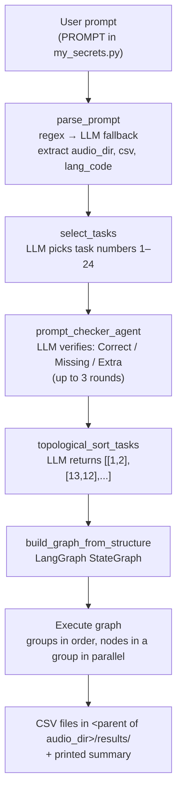

# SpeechQM-Agent: Simplified Methodology

A plain-language walkthrough of what this repo does, how a request flows through it, and which models are used where and why. Sources: the code (`llm.py`, `utility_functions.py`, `my_secrets.py`) and the paper *"Rolling Out Data Quality Overnight, without losing the plot"* (ACL 2026, `ACL2026_Rolling_Out_Data_Quality.pdf`).

---

## 1. The idea in one paragraph

Checking the quality of a large speech dataset (audio + transcripts) by hand is slow and needs experts. SpeechQM-Agent lets you **describe the checks you want in plain English**, for example *"check sample rate, corruption and the domain of the audio in /data/audios/"*. An LLM then:

1. works out which of **24 predefined quality checks** you're asking for,
2. double-checks that selection,
3. orders the checks so that prerequisites run first (you need transcripts before you can classify their domain),
4. runs them as a **graph** (a DAG), with independent checks in parallel,
5. writes one CSV report per check.

The paper reports **80–90% agreement with an expert human verifier at less than 20% of the time and cost**.

---

## 2. End-to-end workflow



### Step by step (with code locations)

| # | Stage | What happens | Where |
|---|---|---|---|
| 0 | **Input** | You put your request in `PROMPT` inside `my_secrets.py` (with HF, OpenAI and Groq keys), then run `python llm.py`. | `my_secrets.py`, `llm.py:1240` |
| 1 | **Parse prompt** | Regex pulls out the audio folder (absolute path), an optional ground-truth `.csv`, and a language code (`hi`, `te`, …). If regex finds nothing, the LLM extracts them as JSON. The paths are then checked to exist. | `llm.py:43` `parse_prompt` |
| 2 | **Task selection** (the "central planner") | The LLM sees the list of 24 tasks plus keyword rules (e.g. "duplicate" means task 23; "IndicLID" means tasks 1 and 15) and returns a comma-separated list of task numbers. | `llm.py:140` `select_tasks` |
| 3 | **Prompt checker** (the verifier) | A second LLM call compares the prompt with the selected tasks and answers `Status: Correct / Missing / Extra`. If tasks are missing, it re-runs selection with that feedback and merges the results. If tasks are extra, it removes them. It does at most 3 rounds. One hard rule: tasks 9, 23 or 24 always pull in task 16 (normalization). | `llm.py:187` `prompt_checker_agent` |
| 4 | **Dependency ordering** | The LLM is told the dependency rules and returns a list of groups, e.g. `[[1, 2], [13, 16, 12], [24]]`. The output is parsed with `ast.literal_eval`, with a regex fallback. If parsing fails, everything goes into one group. | `llm.py:304` `topological_sort_tasks` |
| 5 | **Graph build** | A LangGraph `StateGraph` is built: `start → group 0 → group 1 → … → END`. Every node in group *i* gets an edge to every node in group *i+1*, so nodes in the same group run in the same parallel step. | `llm.py:1176` `build_graph_from_structure` |
| 6 | **Execution** | Each node is a Python function that reads a shared state dict (`CombinedStateDict`) and returns an output string, usually *"CSV saved at …"* or *"Error: …"*. Later nodes find earlier outputs either through the state (for example, key `A` holds the ASR CSV path) or through fixed file paths in `results/`. | `llm.py:1148` `node_map`, `llm.py:1234` |
| 7 | **Output** | All results are written as CSVs to `<parent of audio_dir>/results/` (a few go next to the audio). A summary is printed to the console and logs go to `pipeline.log`. | `llm.py:1235` |

### Hard-coded dependency rules (given to the LLM in step 4)

```
Task 1 (ASR)            → 3, 4, 5, 6, 10, 13, 14, 15, 16
Task 2 (diarization)    → 12, 22
Task 16 (normalization) → 9, 23, 24
```

### The three ways a node gets its work done

The paper calls these `T_lib` (predefined tools) and `T_gen` (LLM-generated tools). In the code they look like this:

| Style | How it works | Used by tasks |
|---|---|---|
| **A. Predefined Python tool** | Plain Python function in `utility_functions.py` / `llm.py`, sometimes wrapping an ML model. Deterministic. | 1, 2, 8, 10, 11, 15, 18, 22, 23, 24 |
| **B. Direct LLM call per row** | Loops over the transcript CSV and sends **one LLM request per row**, e.g. "which domain is this?" | 9, 13 |
| **C. LLM writes and runs code** (ReAct agent + Python REPL) | A LangChain `ZERO_SHOT_REACT_DESCRIPTION` agent gets a natural-language spec such as "write a script that checks sample rate and saves `sample_rate_check.csv`". It writes Python, runs it in a `PythonREPL`, and reports "Success" or "Invalid". This is the paper's "dynamic tool synthesis". | 3, 4, 5, 6, 7, 12, 14, 16, 17, 19, 20, 21 |

The agent is defined at `llm.py:125-138`.

---

## 3. Every model used, and exactly where

### 3.1 LLMs (planning + text-based judgment)

| Model | Provider / how loaded | Where | Purpose |
|---|---|---|---|
| **`gpt-4.1-mini`** (default, active) | OpenAI via `langchain_community.ChatOpenAI` | `llm.py:32` | The **single LLM behind every agentic step**. It does all of the jobs listed in the next table. |
| `llama-3.1-8b-instant` | Groq via `ChatGroq` (**commented out**) | `llm.py:36-42` | Alternative planner for benchmarking. Uncomment it to swap. |
| (any local model) | Ollama via `ChatOllama` (imported, **not wired up**) | `llm.py:12` | The README says local inference is supported; you would have to assign `llm = ChatOllama(...)` yourself. |

**Jobs done by `gpt-4.1-mini`:**

| Job | Location | Calls per run |
|---|---|---|
| Prompt parsing fallback (extract paths/lang as JSON) | `llm.py:71` | 0–1 |
| Task selection (planner) | `llm.py:180` | 1+ (repeats if the checker finds missing tasks) |
| Prompt checker / verifier | `llm.py:268` | up to 3 |
| Topological sort / DAG planning | `llm.py:358` | 1 |
| Brain of the ReAct code-writing agent (tasks 3–7, 12, 14, 16, 17, 19–21) | `llm.py:132` | several per task |
| Domain classification, 1 call per transcript (task 13) | `llm.py:758` | N rows |
| English-word counting for code-mixing, 1 call per transcript (task 9) | `llm.py:1049` | N rows |
| LLM-as-a-Judge coherence/fluency score 0–10 (task 17, via the ReAct agent) | `llm.py:925` | varies |

**LLMs compared in the paper as the planner:** GPT-4o / GPT-4o-mini, GPT-4.1-mini, DeepSeek-R1-distill, LLaMA-3.3-70B, LLaMA-3.1-8B. Their takeaways:
- **GPT-4.1-mini**: best fidelity (99.64% Roman-script detection, 0.094 mean WER, zero hallucinated steps), but slower (136–298 s per batch).
- **LLaMA-3.3-70B**: best speed/accuracy trade-off (under 40 s per batch).
- **DeepSeek-R1**: weak at running pipelines, but best at **domain classification** (0.456 zero-shot on IndicVoices).
- **LLaMA-3.1-8B**: poor (under 30% on QC2), with limited Indic exposure.

### 3.2 Speech / audio models

| Model | Library | Where | Task(s) | Purpose |
|---|---|---|---|---|
| **`ai4bharat/indicwav2vec-hindi`** | HF `Wav2Vec2ForCTC` + `Wav2Vec2Processor` | `utility_functions.py:87-110` (`transcribe_audio`) | **1 – ASR** | Generates a **hypothesis transcript** for every audio file using greedy CTC decoding. Output: `results/indicconf_hypothesis.csv`, column `Indiconformer_Hypothesis`. Everything that needs "transcripts" depends on this. |
| ↳ alternates in the same lookup table | HF | `utility_functions.py:88-94` | 1 | Tamil `Harveenchadha/vakyansh-wav2vec2-tamil-tam-250`, Sanskrit `addy88/wav2vec2-sanskrit-stt`, Marathi `ai4bharat/indicwav2vec-marathi`, Telugu `ai4bharat/indicwav2vec-telugu`. **They are never used**, because the language is hard-coded to `"Hindi"` at `llm.py:482`. |
| **`Harveenchadha/vakyansh-wav2vec2-hindi-him-4200`** | HF `Wav2Vec2ForCTC` | `utility_functions.py:290` (`force_alignment_and_ctc_score`) | **10 – CTC score**, **14 – forced alignment** | Does a **Viterbi forced alignment** of a *given* transcript against the audio (trellis + backtrack, as in the torchaudio tutorial). It returns per-character time stamps and an **average alignment confidence** (the "CTC score"). Task 10 labels each file **Good > 0.7, Medium > 0.5, Poor ≤ 0.5** (`llm.py:651`). A low score means the transcript probably doesn't match the audio. |
| **`pyannote/segmentation-3.0`** + `VoiceActivityDetection` pipeline | pyannote.audio (needs `HF_TOKEN`) | `utility_functions.py:179-186` (**loaded at import time**) | **8 – Silence (VAD)** | Finds speech regions. Silence is computed as total duration minus speech. Output: `results/vad_silence_stats.csv`. |
| **`pyannote/speaker-diarization-3.1`** | pyannote.audio | `utility_functions.py:242` (`save_num_speakers`) | **2 – # speakers + per-speaker duration** | Diarizes each file, counts unique speakers, and sums talk time (in hours) per speaker. Output: `results/num_speakers.csv`. Tasks **12** and **22** build on this file. |

### 3.3 Text / language models

| Model | Where | Task | Purpose |
|---|---|---|---|
| **IndicLID** (three sub-models) | `utility_functions.py:491` (`class IndicLID`), called at `:28` | **15 – Language ID on ASR text** | Identifies the language of each transcript across 47 language-script classes. First it checks what share of characters are Latin. **Native-script text** goes to **IndicLID-FTN** (fastText). **Romanized text** goes to **IndicLID-FTR** (fastText); if that model is not confident it's English (≤ 0.6), the text goes to **IndicLID-BERT**, a classifier using the **`ai4bharat/IndicBERTv2-MLM-only`** tokenizer. Weights are loaded from a **hard-coded server path** `/raid/ganesh/.../trash/` (`:494`), so change it for your machine. |
| **IndicXlit** (`ai4bharat.transliteration.XlitEngine`, beam width 10) | `utility_functions.py:65` | **18 – Transliteration** | Converts Roman-script words in the ground truth into native script (12 languages). ⚠️ The import on line 25 is commented out, so this task currently returns an error until you re-enable it. |

### 3.4 Non-model tools (rules, signal processing, metrics)

| Tool | Where | Task | What it does |
|---|---|---|---|
| FFT energy-ratio heuristic | `utility_functions.py:433` | **11 – Upsampling** | Resamples to 16 kHz and measures spectral energy in **4–8 kHz** as a share of total energy. If the share is **< 2%**, the file is flagged as upsampled from 8 kHz (fake 16 kHz). |
| `jiwer.wer` | `llm.py:1107` | **24 – WER** | Row-by-row WER between the **normalized ground truth** (`normalized_list.csv`) and the **ASR hypothesis**. A high WER means the transcript and audio disagree. |
| pandas `duplicated()` | `llm.py:1069` | **23 – Duplicates** | Finds **exact** repeated strings in every text column of `normalized_list.csv`. |
| `transcript_quality()` | `utility_functions.py:281` | **3 – Transcript quality** | Passes a transcript if it has more than 3 words and at least 70% of them are unique. Otherwise it fails it as too short or repetitive. |
| Unicode range check | (agent-generated) | **6 – Language/script verification** | Checks that every non-punctuation character falls in Devanagari (U+0900–U+097F). |

---

## 4. The 24 tasks at a glance

QC1 = audio and metadata checks; QC2 = transcript and content checks (as grouped in the paper).

| # | Task | QC | Style | Model / tool | Reads | Writes |
|---|---|---|---|---|---|---|
| 1 | ASR transcription | QC1 | A | IndicWav2Vec-Hindi | audio | `results/indicconf_hypothesis.csv` |
| 2 | # speakers + duration | QC1 | A | pyannote diarization 3.1 | audio | `results/num_speakers.csv` |
| 3 | Transcript quality | QC2 | C | heuristic fn | ASR CSV | `transcript_quality.csv` |
| 4 | Grapheme / characters | QC2 | C | — | ASR CSV | `character_list.csv` |
| 5 | Vocabulary | QC2 | C | — | ASR CSV | `vocab_list.csv` |
| 6 | Language (script) verification | QC2 | C | Unicode check | ASR CSV | `language_verification.csv` |
| 7 | Audio length | QC1 | C | — | audio | `audio_length.csv` (in audio dir) |
| 8 | Silence (VAD) | QC1 | A | pyannote segmentation-3.0 | audio | `results/vad_silence_stats.csv` |
| 9 | English word count (code-mix) | QC2 | B | **gpt-4.1-mini** | `normalized_list.csv` | `results/english_word_count.csv` |
| 10 | CTC score | QC2 | A | Vakyansh wav2vec2-Hindi | audio + CSV (`filename`, `ground_truth`) | `results/ctc_scores.csv` |
| 11 | Upsampling check | QC1 | A | FFT heuristic | audio | `results/upsampling_check.csv` |
| 12 | Speaker new vs old | QC1 | C | — | `num_speakers.csv` | `valid_speaker.csv` |
| 13 | Domain classification | QC2 | B | **gpt-4.1-mini** | ASR CSV | `results/domain_check.csv` |
| 14 | Forced alignment | QC2 | C | Vakyansh wav2vec2-Hindi | audio + ASR CSV | `audio_transcript_matching.csv` |
| 15 | Language ID (IndicLID) | QC2 | A | IndicLID FTN/FTR/BERT | ASR CSV | `results/indiclid_language_identification.csv` |
| 16 | Normalization (strip tags) | QC2 | C | regex (agent-written) | `results/indicconf_hypothesis-gt.csv` | `results/normalized_list.csv` |
| 17 | LLM-as-a-Judge score (0–10) | QC2 | C | **gpt-4.1-mini** | ASR CSV | `llm_scores.csv` |
| 18 | Transliteration | QC2 | A | IndicXlit | user GT CSV + lang code | `<gt>_transliterated.csv` |
| 19 | Corruption check | QC1 | C | file size / extension | audio | `corruption_check.csv` |
| 20 | Extension / format | QC1 | C | extension check | audio | `audio_format_check.csv` |
| 21 | Sample rate (16 kHz) | QC1 | C | librosa / soundfile | audio | `sample_rate_check.csv` |
| 22 | Per-speaker total duration | QC1 | A | pandas | `num_speakers.csv` | `results/speaker_durations.csv` |
| 23 | Utterance duplicates | QC2 | A | pandas | `normalized_list.csv` | `results/duplicate_utterances.csv` |
| 24 | WER | QC2 | A | jiwer | normalized GT + ASR | `results/wer.csv` |

**Expected folder layout** (from the README and the code):

```
<dataset>/
├── audios/                        ← pass THIS absolute path in the prompt
└── results/
    ├── indicconf_hypothesis-gt.csv   ← your ground-truth transcripts (for 16 → 9/23/24)
    └── ... (all generated CSVs land here)
```

Note that tasks 1, 2, 8, 15 and 16 **skip themselves if their output file already exists**. Delete `results/` to force a fresh run.

---

## 5. Worked example (from the paper, Appendix F)

> *"Check the audio files of the speech dataset on sample rate, audio file corruption, and domain with audio_dir: xyz/test/."*

1. **Select:** 21 (sample rate), 19 (corruption), 1 (ASR), 13 (domain).
2. **Check:** the checker confirms the selection. Task 1 is required because domain needs transcripts.
3. **Sort:** `[[1, 19, 21], [13]]`.
4. **Run:** the ReAct agent writes scripts for 19 and 21, IndicWav2Vec transcribes (1), all in parallel. Then gpt-4.1-mini labels each transcript's domain (13).
5. **Output:** `sample_rate_check.csv`, `corruption_check.csv`, `indicconf_hypothesis.csv`, `domain_check.csv`.

---

## 6. SpeechQM-Dataset (paper only; this generation code is *not* in the repo)

This is a synthetic benchmark used to test the agent: **15.51 hours** of Hindi, 110 speakers (54 F / 56 M), 19 native-language accents, 11 domains × 55 settings.

| Stage | What happens | Models |
|---|---|---|
| 1. Dialogue generation | About 100-turn English two-speaker conversations per topic/setting | **LLaMA-3.3-70B, GPT-4o / 4o-mini, DeepSeek-R1-distill** (split across domains, Table 9) |
| 2. Translation | Translated into Hindi (Devanagari). English loanwords are kept inside `<eng>…</eng>`; tags like `[noise]` and `[laugh]` are inserted | Multilingual LLMs |
| 3. Metadata + perturbation | An LLM extracts domain, topic and speaker JSON. Random perturbations (HTML tags, token swaps, rare words) are added past a threshold θ | LLM + rules |
| 4. Speaker attribution + TTS | Speaker IDs and demographics are borrowed from **LAHAJA**; a speaker-conditioned TTS model produces the audio | TTS model (not named in the paper) |
| 5. Corruption + export | Optional audio/text corruption (clipping, dropped tokens); export as JSON/XML | — |
| Throughout | LLM-as-a-Judge filters hallucinations and inconsistencies | LLM |

**Evaluation splits ("vendors"):**
- **Vendor A:** QC1 errors injected into 3,000 LAHAJA samples.
- **Vendor B:** QC2 errors injected into 3,000 samples.
- **Vendor C:** both kinds of errors in 100 samples.
- **Vendor D:** fully synthetic data.

Each vendor is split by difficulty: `-1` = 1 error, `-2` = 2 errors, `-3` = 3 or more errors. **IndicVoices** was also used (domain classification, 500 utterances).

---

## 7. Headline results (paper)

- **Agreement with experts:** 80–90%, in under 20% of the time and cost. The human expert takes more than 2,500 s per batch; static single-agent pipelines reach only about 0.4 accuracy.
- **Downstream ASR training:** a random Bhashini subset gave **12.9 WER**. An agent-curated subset gave **9.8 WER**, matching Shrutilipi (human-in-the-loop curation).
- **Real vendor audit:** a 12,000-hour, 8-language corpus. Of 6,000 hours validated so far, **1,950 hours (32.5%) were flagged**: 800 h with low sample rate, 300 h with Roman-script transcripts, 200 h silence-only, 200 h proxy speakers, 100 h misaligned, 500 h duplicated, and 987 corrupt files.

---

## 8. Paper vs. code: where they differ

These are useful to know before you trust or extend the code:

| Paper says | Code actually does |
|---|---|
| A monitoring agent retries failed nodes *r* times and re-plans | No retry or replanning loop. Each node catches exceptions and returns an `"Error: …"` string. |
| Results are aggregated into a dashboard | CSV files plus a printed summary. |
| Audio-based language ID (MMS) | Text-based LID only (IndicLID on ASR output). There is no audio LID model. |
| MoE WER/CER from multiple ASR models | One ASR model plus `jiwer` WER against ground truth. No CER. |
| Speaker reuse found via embeddings against public/private datasets | Compares pyannote labels (`SPEAKER_00`, …) across files. These labels are local to each file, so "old speaker" detection is very rough. |
| Duplicates found via n-gram and embedding overlap | Exact string match only. |
| Timestamp-based segmentation task | Not implemented. |
| Appendix J prompts list 18 tasks (e.g. #9 = sample rate) | The code has 24 tasks with different numbering (#9 = English word count, #21 = sample rate). |
| Multilingual | ASR is hard-coded to Hindi (`llm.py:482`), the domain prompt says "Hindi language expert", and script verification is Devanagari-only. |

**Other gotchas noticed while reading:**
- **File names don't match the model.** The ASR output is called `indicconf_…` / `Indiconformer_Hypothesis` (as if it came from IndicConformer), but the model is actually **IndicWav2Vec**.
- **Slow by design in places.** The ASR and alignment models are reloaded for every file, and IndicLID is reloaded for every transcript.
- **The status strings returned by the ReAct tasks (19, 20, 21) aren't reliable**, because they check the agent's response dict incorrectly. Read the CSVs themselves, not the printed status.
- **Column-name assumptions vary between tasks.** Task 10 expects `filename` / `ground_truth`, while task 1 writes `Filename` / `Indiconformer_Hypothesis`. Make sure the CSV in `results/` has the columns each task expects.
- **Hard-coded paths.** The IndicLID weights path (`utility_functions.py:494`) and the example paths in `PROMPT` point to the original authors' server.
